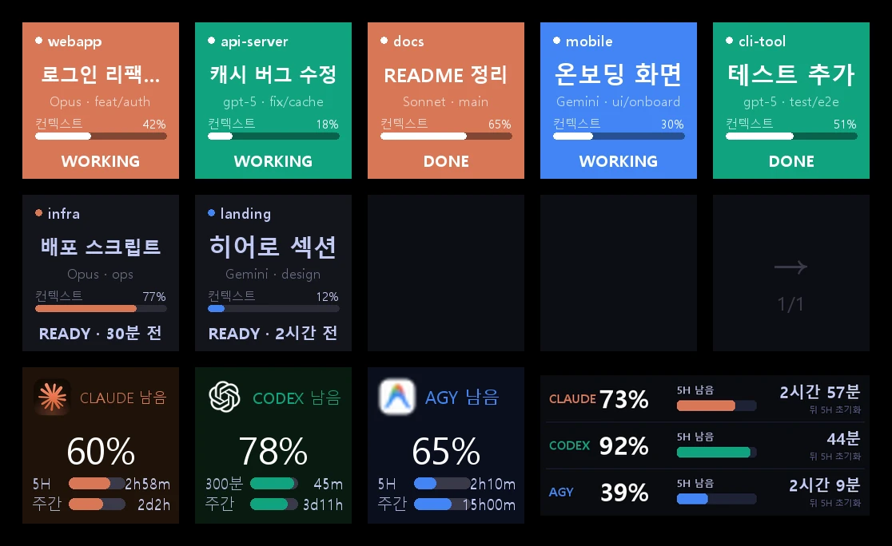

<h1 align="center">agentmon</h1>

<p align="center">
  <a href="README.md">English</a>
  &nbsp;&nbsp;|&nbsp;&nbsp;
  <a href="README.ko.md">한국어</a>
</p>

<p align="center">
  코딩 에이전트(Claude Code, Codex, Antigravity, Cursor)의 세션 상태와 한도를<br>
  Ulanzi D200 덱에 띄웁니다.
</p>

<p align="center">
  <a href="https://dont-do-it-now.github.io/Agentmon/">웹사이트</a>
  &nbsp;&nbsp;|&nbsp;&nbsp;
  <a href="https://github.com/Dont-Do-it-Now/Agentmon/releases">릴리즈</a>
</p>

<p align="center">
  
</p>

## v0.2.0 새 기능

- **Cursor 에이전트** — Cursor transcript 파일을 읽어 세션 감지·포커스, 다른 에이전트와 동일하게 동작
- **Herdr 연동** — [Herdr](https://herdr.io) 안에서 에이전트를 실행 중이면 세션 타일을 눌렀을 때 Herdr 화면이 해당 터미널 탭으로 이동. Herdr가 꺼져 있으면 앱 딥링크로 fallback
- **동적 하단 타일 (버튼 12)** — Antigravity, Cursor 등 나머지 에이전트를 최근 활동 기준 자동 선택, 누르면 순환
- **한도 타일 에이전트 아이콘** — 하단 타일 좌상단에 각 에이전트 로고 표시
- **상태 아이콘** — 한도 조회 중·로그인 필요 상태를 타일과 넓은 패널에 전용 아이콘으로 표시

## 기능

- 세션 타일(페이지당 9개): 에이전트 색으로 채워지고 모델·브랜치·컨텍스트 바 표시
- 완료·미확인 세션은 누를 때까지 깜빡이고, 누르면 해당 세션 열기 (Herdr 실행 중이면 탭 이동)
- 458x196 넓은 패널: 에이전트당 한 줄, 한도 바 2개(5시간·주간)
- 하단 타일: 앞 2칸 고정(Claude·Codex), 3번째 칸은 나머지 에이전트를 자동 선택하며 순환
- 에이전트는 독립 모듈이라 추가해도 대시보드 코드를 고치지 않습니다
- 로컬 파일과 로컬 앱만 읽고, 한도는 각 에이전트의 자체 서비스에서 가져옵니다

## 요구사항

- Windows
- Ulanzi D200 (USB 연결)
- Python 3 (`hidapi`, `Pillow`, `certifi`, `psutil`; `requirements.txt` 참고)
- 지원 에이전트 중 하나 이상 설치: Claude Code, Codex, Antigravity, Cursor

## 설치와 실행

```bat
python -m venv .venv
.venv\Scripts\pip install -r requirements.txt
.venv\Scripts\python.exe dashboard.py
```

또는 `deploy.bat`을 실행하면 `.venv` 생성, 패키지 설치, 실행까지 합니다.

창 없이 실행하려면 `run_silent.vbs`를 씁니다 (`run_log.bat`이 `logs/dashboard.log`에 기록).
로그인 때마다 자동 시작하려면 `install_startup.bat`을 관리자 권한으로 실행하세요.

재시작: 명령줄에 `dashboard.py`가 있는 python 프로세스를 끝내고 `wscript.exe run_silent.vbs`를 실행합니다.

## 덱 조작

| 버튼              | 동작                                                                                      |
| ----------------- | ----------------------------------------------------------------------------------------- |
| 세션 타일 (0~8)   | 확인 처리하고 해당 세션 열기 (Herdr 실행 중이면 해당 터미널 탭으로 이동)                  |
| 다음 (9)          | 다음 세션 페이지, 마지막 페이지에서 누르면 1페이지                                        |
| 하단 고정 (10~11) | 고정 에이전트 한도(5H·주간 바). 누르면 남은 ↔ 사용 % 전환 + 갱신                         |
| 하단 순환 (12)    | 나머지 에이전트(Antigravity, Cursor…) 순환하며 같은 전환 적용                             |

## 에이전트 추가

1. `agents/<이름>.py`를 만들고 상수 `KEY, LABEL, SHORT, COLOR, BG, APP_TITLE`을 둡니다.
2. `sessions() -> list[AgentSession]` 구현 (`state`는 `"running"` 또는 `"done"`, 눌러서 열 주소는 `focus_url`).
3. `usage()` 구현: `.limits -> list[Limit]`를 가진 객체, 앱이 꺼져 있으면 `None`.
4. 선택: 딥링크만으로 세션이 안 열리면 `focus(session)`.
5. `agents/__init__.py`의 `MODULES`에 추가합니다. 순서가 표시 순서입니다.

`dashboard.py`와 `panel.py`는 고치지 않습니다. 하단 앞 2칸은 고정 모듈이 차지하고, 2번째 인덱스부터의 모듈이 3번째 칸을 공유하며 누를 때마다 순환합니다.
자세한 내용은 [AGENTS.md](AGENTS.md)를 보세요.

## 참고

- Claude 한도 API는 자주 부르면 429가 나서 `agents/claude.py`가 120초 캐시합니다.
- `agents/claude.py`는 만료된 Claude Code 토큰을 갱신해 `~/.claude/.credentials.json`에 다시 씁니다.
- 토큰·CSRF 값은 로그에 남기지 않습니다.

## 라이선스

MIT License. [LICENSE](LICENSE) 참고. 한국어 참고 번역은 [LICENSE.ko.md](LICENSE.ko.md)입니다.

---

Ulanzi, Claude, Codex, Antigravity, Cursor, Herdr는 각 소유자의 상표입니다. agentmon은 이들과 제휴하거나 보증을 받지 않습니다.
