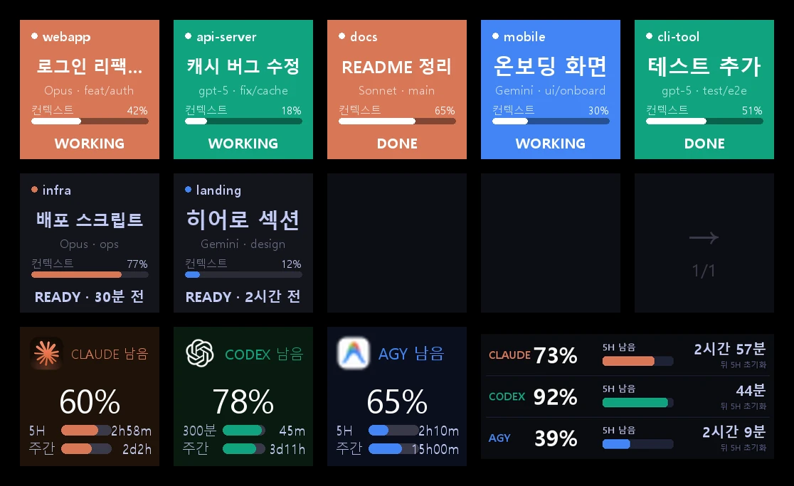

<h1 align="center">agentmon</h1>

<p align="center">
  <a href="README.md">English</a>
  &nbsp;&nbsp;|&nbsp;&nbsp;
  <a href="README.ko.md">한국어</a>
</p>

<p align="center">
  Show the session status and usage limits of your coding agents<br>
  (Claude Code, Codex, Antigravity) on an Ulanzi D200 deck.
</p>

<p align="center">
  <a href="https://dont-do-it-now.github.io/Agentmon/">Website</a>
</p>

<p align="center">
  
</p>

## Features

- Session tiles (9 per page) filled with the agent's color, with model, branch and a context bar
- Finished or unread sessions blink until you press them; pressing a tile opens that session
- Wide 458x196 panel with one row per agent and two limit bars (5-hour and weekly)
- Bottom tiles show each agent's limit; press one to switch remaining / used % and refresh
- Agents are independent modules, so adding one touches no dashboard code
- Reads only local files and local apps; limits come from each agent's own service

## Requirements

- Windows
- Ulanzi D200 (connected over USB)
- Python 3 (`hidapi`, `Pillow`, `certifi`, `psutil`; see `requirements.txt`)
- At least one supported agent installed: Claude Code, Codex, or Antigravity

## Install and run

```bat
python -m venv .venv
.venv\Scripts\pip install -r requirements.txt
.venv\Scripts\python.exe dashboard.py
```

Or run `deploy.bat`, which creates `.venv`, installs the requirements and starts the dashboard.

To run without a window, use `run_silent.vbs` (`run_log.bat` writes `logs/dashboard.log`).
To start it at every login, run `install_startup.bat` as administrator.

To restart: end the python process whose command line contains `dashboard.py`, then run `wscript.exe run_silent.vbs`.

## Deck controls

| Button               | Action                                                                                  |
| -------------------- | --------------------------------------------------------------------------------------- |
| Session tiles (0-8)  | Mark as seen and open that session                                                      |
| Next (9)             | Next session page; from the last page back to page 1                                    |
| Bottom tiles (10-12) | Per-agent limits (5H and weekly bars). Press any to switch remaining / used % and refresh |

## Adding an agent

1. Create `agents/<name>.py` with the constants `KEY, LABEL, SHORT, COLOR, BG, APP_TITLE`.
2. Implement `sessions() -> list[AgentSession]` (`state` is `"running"` or `"done"`; `focus_url` is what opens on press).
3. Implement `usage()` returning an object with `.limits -> list[Limit]`, or `None` when the app is off.
4. Optionally add `focus(session)` when a deep link alone cannot open the session.
5. Add the module to `MODULES` in `agents/__init__.py`. Its order is the display order.

`dashboard.py` and `panel.py` stay untouched, except that only the first three modules fit the bottom limit tiles.
See [AGENTS.md](AGENTS.md) for details.

## Notes

- The Claude limit API returns 429 if called too often, so `agents/claude.py` caches it for 120 seconds.
- `agents/claude.py` refreshes an expired Claude Code token and writes it back to `~/.claude/.credentials.json`.
- Tokens and CSRF values are never logged.

## License

MIT License. See [LICENSE](LICENSE); a Korean reference translation is in [LICENSE.ko.md](LICENSE.ko.md).

---

Ulanzi, Claude, Codex and Antigravity are trademarks of their respective owners. agentmon is not affiliated with or endorsed by them.
